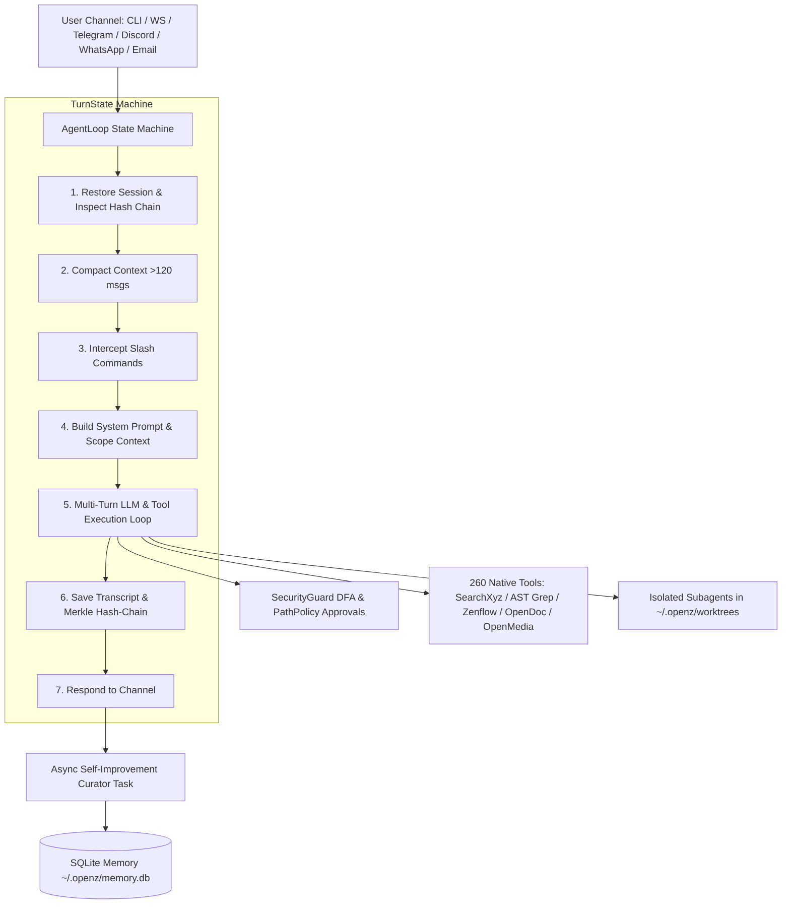

<p align="center">
  
</p>

<h1 align="center">OpenZ 🦊</h1>

<p align="center">
  <strong>High-Performance, Local-First Async Personal AI Agent Framework in Rust</strong>
</p>

<p align="center">
  <a href="https://github.com/aswin402/openz-rs"></a>
  <a href="https://www.rust-lang.org/"></a>
  <a href="https://tokio.rs/"></a>
  <a href="https://github.com/aswin402/openz-rs/blob/main/LICENSE"></a>
  <a href="https://github.com/aswin402/openz-rs"></a>
</p>

---

OpenZ is a local-first AI agent runtime built in Rust. It combines an interactive terminal agent (TUI), **260 native in-process tools**, durable SQLite cognitive memory (`~/.openz/memory.db`), browser-backed research, document/media automation pipelines, multi-channel communication (CLI, WebUI, Telegram, Discord, WhatsApp, Email), and isolated subagents into one fast desktop-oriented binary.

Maintainer: **Aswin** ([@aswin402](https://github.com/aswin402)) — Rebranded from `nanobot`.

---

## ⚡ Why OpenZ?

Most agent frameworks require users to manually select tools, switch providers, or manage complex configuration options. OpenZ is engineered to handle tool orchestration and self-healing automatically:

- 🔍 **Resilient Web Research**: Scraper blocked? OpenZ falls back to provider-free local browser discovery.
- 🌐 **JS App Shell Handling**: Dynamic single-page web app? Retries automatically through GSD → Firefox → Obscura CDP rendering.
- 📄 **Document Intelligence**: Scanned PDF or image with no text? Automatically triggers native OCR.
- 📂 **Context Scoping**: Modifying code? Automatically walks directory trees and loads local `AGENTS.md` rules via `scope_context` before editing.
- 📦 **Transactional Edits**: Performs Rust edits via `zenflow_edit` checkpoints (`.zenflow_bak`), runs `cargo check` and `cargo clippy`, and rolls back cleanly if checks fail.
- 👁 **Auto-Display Artifacts**: Asks to show/view a generated file? OpenZ auto-opens it using device inventory application suggestions.

---

## ✨ Core Capabilities

| Capability | Overview |
|---|---|
| 🖥 **Agent Runtime** | Interactive TUI, streaming/non-streaming completions, parallel read-only tool batches, cancellation, session persistence, SHA-256 Merkle history verification (`ChainIntegrity`) |
| 🔎 **Web & Research** | `SearchXyz` local-first search engine, direct URL fetching with SSRF IP-pinning, cache revalidation, source ledger, research briefs |
| 🌐 **Browser Automation** | GSD browser engine, Firefox/WebDriver, Obscura CDP headless browser, preflight diagnostics |
| 🧠 **Cognitive Memory** | SQLite structured memory (`~/.openz/memory.db`), vector embeddings (`embeddings_cache.db`), working memory, knowledge graph (`graph_memory.db`) |
| 🛠 **Native Code Tools** | Structural `ast_grep`, code outline, grep, Rust docs lookup, Cargo manager, compiler auto-heal |
| 📝 **Filesystem & Edits** | `Hashline` content-hash anchors (`read_file` + `replace_lines`), exact/fuzzy/search-replace `patch_file`, transactional Zenflow checkpoint edits, `PathPolicy` containment |
| 📊 **Document Pipelines** | PDF, DOCX, XLSX, PPTX, CSV extraction & creation, Poppler/Tesseract OCR fallback, document complexity analysis |
| 🎨 **Media Pipelines** | Image generation, SVG compilation & animation, OpenMedia graphics, programmatic MP4 video via Wavyte engine |
| 🤖 **Subagents** | 19 built-in profiles (planner, researcher, reviewer, etc.) + typed multi-agent `orchestrate_workflow` runtime |
| 💬 **Channels** | Interactive TUI, WebSocket gateway & React WebUI (port 8765), Telegram, Discord, WhatsApp, Email (IMAP/SMTP) |
| ⏱ **Automation & SOPs** | DAG SOP workflows, cron jobs (`schedule_job`), autonomous `daemon` mode, background self-improvement curator, `doctor` diagnostics |
| 🔌 **Extensibility** | Stdio MCP client support, `mcp-bridge` gRPC-to-stdio bridge, prompt-aware layered tool routing (`ScopeEngine`), single-turn `batch_execute` in `tool_catalog` |

---

## 🆕 Latest Highlights

### 🧭 Next-Generation Tool Routing, `Hashline` Edits & Parallel Batch Execution
- **Turn-Sticky Working Set & KV-Cache Prefix Ordering**: Executed non-core domain tools automatically remain mounted in a bounded turn-decaying working set (`STICKY_TOOL_TTL_TURNS = 2`, `MAX_STICKY_TOOLS = 8`) across follow-up prompts, while `to_openai_format_for_prompt` orders `Core` tools as a deterministic prefix before scoped tools to preserve LLM provider KV prompt caches.
- **`Hashline` Content-Hash Anchors & Fuzzy/Search-Replace Patching**: `read_file` supports `include_hashes: true` (`<line_no>:<4-char-fnv1a-hash>| <content>`), `replace_lines` auto-relocates drifted line numbers via `expected_hash` or `anchor_text`, and `patch_file` supports exact unified diffs, fuzzy whitespace-normalized hunks, and `target`+`replacement` / `<<<<<<< SEARCH ... >>>>>>> REPLACE` blocks.
- **Parallel Read-Only Tool Batches & Single-Turn `batch_execute`**: Pure read-only tool batches execute concurrently via `futures_util::future::join_all` (`prefetch_parallel_safe_batch`), and `tool_catalog` supports programmatic `batch_execute` for up to 8 safe tool calls in a single turn with per-step `SecurityGuard` and `ToolResourcePolicy` enforcement.
- **Unified Alias Canonicalization & Turn Cancellation**: Tool compatibility aliases and camelCase/snake_case path arguments normalize through a single pipeline, and dynamically resolved subagent/orchestration tools inherit the active turn's `CancellationToken`.

### 💻 TUI Ergonomics & Multi-line Prompt Wrapping
- **Visible Terminal Cursor**: Explicit terminal hardware cursor (`crossterm::cursor::Show`) on raw mode start and every render frame.
- **Multi-line Input Prompt Wrapping**: Vertical multi-line wrapping with dynamic prefixes (`> ` on line 0, `- ` on wrapped lines).

### 🔒 Privacy, Trace & Safety Hardening
- **Pure DFA Shell & Multimodal Guard**: Quote-aware DFA shell lexer inspecting newline-separated commands, `$(...)`/backtick command substitutions, and 12 interpreter pipe targets, paired with a non-regex multimodal image scanner enforcing SSRF IP checks, `PathPolicy`, and binary magic-byte verification.
- **Tamper-Preserving Merkle Audit Trail**: `Session::inspect_hash_chain()` migrates legacy unhashed sessions while preserving tampered sessions on disk and flagging `integrity_compromised = true` for `/audit`.
- **Private Reasoning/Traces**: Trace output is private by default across public channels. Toggle with `/tui trace full|compact|off`.
- **Raw Tool Output Restoration**: Tool outputs >4,000 chars are stored under `~/.openz/tool_outputs/` and restored losslessly via `retrieve_original`.
- **Secret Redaction**: `openz doctor --scrub-secrets` redacts historical leaked secrets from sessions, traces, and tool outputs while atomically re-signing session Merkle hash chains.

---

## 🚀 Quick Start

### 1. Prerequisites & Supported Environments
- **OS**: Linux (x86_64 / aarch64), macOS, or Windows.
- **Rust Toolchain**: Rust **1.82+** (`cargo`, `rustc`) and Protocol Buffers compiler (`protoc` for `build.rs` gRPC compilation).
- **Linux Fontconfig Note**: Set `RUST_FONTCONFIG_DLOPEN=1` when compiling on Linux systems without `libfontconfig1-dev` pkg-config headers (`localinstall.sh`, `localupdate.sh`, and `justfile` set this automatically).
- **Optional**: Node.js 18+ & `npm` (to build the `web/` React/Vite WebUI bundle), `just` command runner, Chromium/Firefox for browser automation tools.

### 2. Installation & Build

```bash
# Clone the repository
git clone https://github.com/aswin402/openz-rs.git
cd openz-rs

# Build release binary (with dynamic fontconfig dlopen on Linux)
RUST_FONTCONFIG_DLOPEN=1 cargo build --release
```

The release binary will be written to `target/release/openz`.

#### Local System Installation

```bash
# Recommended: balanced CPU/RAM installer (also builds ~/.openz/web/dist if npm is present)
./localinstall.sh --balanced

# Low-resource machines (1 job, low-RAM profile, optional target/ cleanup):
./localinstall.sh --low-resource --clean-target
```

### 3. Initial Setup & Launch

```bash
# 1. Run first-time setup wizard
openz onboard

# 2. Configure providers, channels, and security options
openz configure

# 3. Start interactive TUI terminal agent
openz
```

---

## ⌨️ TUI Slash Commands Cheatsheet

While in OpenZ TUI mode, type `/` to access built-in slash commands:

| Command | Description |
|---|---|
| `/help` | Show available slash commands |
| `/status` | Inspect active provider, model, session, and runtime status |
| `/audit` | Verify the session's SHA-256 cryptographic Merkle hash chain |
| `/compact` | Manually trigger LLM context compaction and memory consolidation |
| `/clear` | Clear terminal screen |
| `/tui` | Manage TUI settings (e.g. `/tui trace full\|compact\|off`) |
| `/model` | View or switch active default LLM model |
| `/history` | Interactively restore or switch sessions |
| `/logs` | Stream color-coded structured runtime logs |
| `/mcps` | List connected MCP servers |
| `/memory` | Inspect cognitive metadata & working memory |
| `/skills` | List and inspect procedural skills stored in SQLite |
| `/subagents` | View available specialized subagent profiles |
| `/sops` | List Standard Operating Procedure (SOP) workflows |
| `/doctor` | Run runtime health, database, and disk diagnostics |
| `/servers` | List OpenZ-launched background servers |
| `/stop-server` | Stop background server by ID, or all |
| `/streaming` | Toggle response streaming mode |
| `/new-session` | Start a fresh session |
| `/exit` | Exit OpenZ terminal agent |

---

## 🏗 Architecture & Execution Flow



The implementation is split by responsibility: `src/agent/agent_loop/` contains
the `TurnState` phases (`restore.rs`, `compact.rs`, `command.rs`, `build.rs`, `run/`, `save.rs`), `src/channels/websocket/` contains the typed WebSocket
protocol and handlers, and `src/memory/` provides the shared facade over the
separate memory (`memory.db`), graph (`graph_memory.db`), and embedding-cache (`embeddings_cache.db`) SQLite databases. Native tool registration
lives in `src/cli/tools.rs` (backed by `src/tools/registry.rs` and `src/tools/scope_engine.rs`), while the OpenMedia MCP server
composes focused handler modules under `src/tools/openmedia/mcp/`.

---

## 🔒 Safety & Hardening Architecture

OpenZ includes multi-layered safety controls:

1. **SecurityGuard DFA Gate (`src/agent/security.rs`)**: Tokenizes shell commands with a quote-state DFA lexer, unwraps `$(...)`/backtick substitutions and inline scripts (`sh -c`, `python3 -c`, `node -e`), hard-blocks destructive root/system/workspace-core deletions (`.git` recursively, `Cargo.toml`, `src`, `build.rs`), disk formatting, and host power commands (`is_forbidden`), and requires explicit user confirmation across all security modes for privilege escalation and pipes into 12 shells/interpreters (`sh`, `bash`, `zsh`, `dash`, `ksh`, `fish`, `python`, `python3`, `perl`, `ruby`, `node`, `php`).
2. **PathPolicy & Multimodal Verification (`src/config/path_policy.rs`, `src/providers/mod.rs`)**: Restricts file reads/writes to the active workspace, `~/.openz`, and OS temp directories while blocking sensitive dotfiles (`.env`, `.ssh`, `.aws`). Outbound multimodal image parsing verifies binary magic signatures (PNG, JPEG, GIF, WEBP) and SSRF IP safety.
3. **Linux seccomp BPF Sandbox (`src/tools/shell.rs`)**: Optional subprocess BPF filter (`enable_sandbox` in `~/.openz/config.json`, `false` by default to allow compiler and browser toolchains; toggle via `openz configure`) restricting child processes to ~110 allowed syscalls with `PR_SET_NO_NEW_PRIVS` and `RLIMIT` caps.
4. **Subagent Worktree Isolation**: Subagents launched from non-project workspace roots operate inside isolated scratch worktrees under `~/.openz/worktrees`.
5. **Secret Scrubbing & Merkle Audit Ledger**: Built-in secret redaction in config views and logs, `openz doctor --scrub-secrets` with atomic Merkle hash re-signing, and `/audit` tamper detection.

---

## 💻 Common CLI Commands

| Command | Purpose |
|---|---|
| `openz` / `openz agent` | Start interactive TUI terminal chat |
| `openz run -p "<prompt>" [-y] [--format text\|json\|stream-json]` | Execute headless prompt (also supports `-f <file>`, `-c`/`--continue`, and piped stdin) |
| `openz daemon [--interval-secs 300]` | Start autonomous background daemon loop |
| `openz configure` | Full interactive config UI (providers, gateway, channels, sandbox) |
| `openz onboard` | First-time provider setup wizard |
| `openz gateway` | Start WebSocket gateway server & WebUI (`channels.websocket.host`/`port` in `~/.openz/config.json`, default `127.0.0.1:8765`) |
| `openz telegram` | Start Telegram bot polling listener |
| `openz discord` | Start Discord bot gateway listener |
| `openz whatsapp` | Start WhatsApp Business API webhook receiver (port 8090) |
| `openz email` | Start Email IMAP/SMTP polling channel |
| `openz subagent` | Interactive manager for subagent profiles |
| `openz skills <list\|inspect\|delete>` | Manage procedural skills in SQLite |
| `openz sop <list\|instances\|trigger\|resume>` | Manage and trigger stateful SOP DAG workflows |
| `openz mcp-bridge --port <N> -- <cmd> [args...]` | Run gRPC-to-stdio MCP bridge |
| `openz doctor [--scrub-secrets] [--fail-on-warn]` | Verify runtime health, relocate stray DBs, and optionally scrub leaked secrets |
| `openz logs [--tail N] [--level info] [--session auto]` | View real-time color-coded structured logs |
| `openz changelog` | View hardware footprint specifications and release history |
| `openz streaming` | Toggle response streaming preference via wizard |
| `openz tui` | Experimental multi-pane Ratatui TUI preview |

---

## ⚙️ Configuration & Environment

Configuration is stored under `~/.openz/config.json`. Override the runtime directory with:

```bash
export OPENZ_CONFIG_DIR=/path/to/openz-runtime
```

### Key `agents.defaults` Settings (`~/.openz/config.json`)
- `model` / `provider`: Active model and provider (`"auto"` resolves provider by model prefix and available API keys across 14 supported providers).
- `max_tokens` (`4096`), `temperature` (`0.1`), `max_messages` (`120`), `max_tool_iterations` (`200`), `tool_timeout_secs` (`300`).
- `caveman_mode` (`true` by default): Injects a concise response directive; set to `false` for verbose output.
- `security_mode` (`"normal"` by default; options: `"strict"`, `"normal"`, `"loose"`).
- `enable_sandbox` (`false` by default): Enables Linux seccomp BPF syscall filtering on `exec_command`.
- `layered_tool_routing` (`true` by default): Dynamically scopes exposed tools per turn via `ScopeEngine`.

Environment variables take precedence over config file keys:

```bash
export OPENAI_API_KEY="your-key"
export ANTHROPIC_API_KEY="your-key"
export DEEPSEEK_API_KEY="your-key"
export GROQ_API_KEY="your-key"
export OPENROUTER_API_KEY="your-key"
export MINIMAX_API_KEY="your-key"
export MISTRAL_API_KEY="your-key"
export NVIDIA_API_KEY="your-key"
export CEREBRAS_API_KEY="your-key"
export GOOGLE_AI_STUDIO_API_KEY="your-key"
```

---

## 🧪 Development & Targeted Testing

Use the low-resource recipes in [`justfile`](file:///home/aswin/programming/vscode/myProjects/ai_agent_tools/openz/justfile) (capped at `-j 1` with `RUST_FONTCONFIG_DLOPEN=1`) to validate changes without exhausting system RAM:

```bash
# Fast type-check of the openz package (-j 1)
just check openz

# Run a single targeted unit test (-j 1)
just test-one test_native_tool_registration_names openz
just test-one test_newline_and_substitution_whitelist_bypass_and_pipe_targets openz

# Or invoke cargo directly with conservative parallelism
RUST_FONTCONFIG_DLOPEN=1 cargo test -p openz --lib <test_filter> -j 1
```

---

## 🚧 Known Limitations & Roadmap Status

- **Linux-Only Seccomp Sandbox**: The BPF syscall filter in `src/tools/shell.rs` is compiled on Linux (`#[cfg(target_os = "linux")]`) and is a no-op on macOS and Windows; `SecurityGuard` and `PathPolicy` remain active on all platforms.
- **Post-Generation Tool Interception**: `SecurityGuard` inspects tool calls before execution but after the LLM has emitted the tool call tokens.
- **Experimental Multi-Pane TUI**: `openz tui` is an experimental multi-pane Ratatui preview, whereas `openz` / `openz agent` is the primary production terminal interface.

---

## 📄 License

Dual-licensed under **MIT** or **Apache-2.0**. See Cargo metadata for terms.
