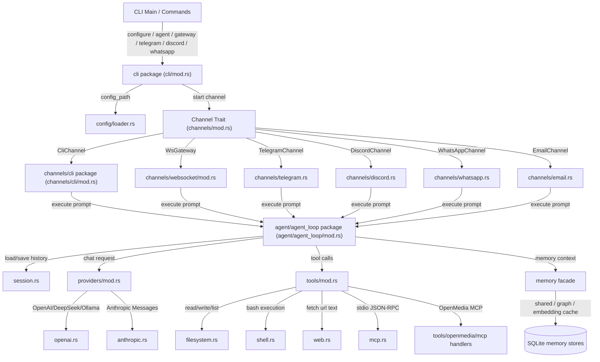

# OpenZ Architecture 🦊

This document describes the design, execution flow, and module architecture of OpenZ.

**Official GitHub Repository:** [github.com/aswin402/openz-rs](https://github.com/aswin402/openz-rs)

---

## 1. Architectural Overview

`openz` is a modular, high-performance, asynchronous AI agent and gateway designed in Rust. It utilizes the `tokio` runtime for executing non-blocking I/O, subprocess spawns, and networking concurrently.

---

## 2. Core Modules

* **`config/`**: Handles loading, updating, and writing configurations to `~/.openz/config.json`.
* **`providers/`**: Implementations for LLM APIs (OpenAI-compatible and Anthropic Messages).
* **`tools/`**: Registry and implementations for native tools, subagent delegation, and MCP stdio wrapper tools.
* **`cron/`**: Handles scheduling and execution of background cron tasks.
* **`session.rs`**: Stores conversation message logs and dynamic summaries in JSON files under `~/.openz/sessions/`. Implements **SHA-256 Merkle Hash-Chains** linking every interaction, verifying history integrity on load.
* **`agent/agent_loop/`**: The core execution state machine (`TurnState`) package. `mod.rs` owns orchestration while `restore.rs`, `compact.rs`, `build.rs`, `run/`, `save.rs`, and the focused support modules isolate each turn phase. It also spawns the asynchronous background self-improvement curator task.
* **`agent/skills.rs`**: Manages long-term procedural skills and facts stored inside a structured **SQLite database (`~/.openz/memory.db`)**, migrating legacy flat markdown files automatically on startup.
* **`agent/activity.rs`**: Tracks global execution states (active session ID, status, and currently running tool) to `~/.openz/activity.json`, providing other communication channels with real-time awareness of what the agent is doing on the machine.
* **`channels/`**: Pluggable communication adapters conforming to a unified `Channel` trait. The WebSocket gateway is organized under `channels/websocket/` with typed protocol payloads and command families; the CLI has focused input, rendering, and MCP modules. Current adapters include Terminal CLI, WebSocket Gateway, Telegram Polling, Discord Gateway, WhatsApp Webhooks, and a pure-Rust Email IMAP/SMTP channel.
* **`memory/`**: Additive memory facade exposing shared domain types, scope derivation, database repositories, embedding selection, and compatibility metadata across `memory.db`, `graph_memory.db`, and `embeddings_cache.db` without changing existing schemas.
* **`tools/openmedia/mcp/`**: OpenMedia’s MCP server with one composed `ToolRouter`; rendering, image processing, animation, improvement, SVG, template, and video handlers live in separate modules while the root retains shared DTOs and helpers.
* **`sop/`**: Resilient multi-step Directed Acyclic Graph (DAG) templates executing step tasks in parallel via Tokio. Performs dependency cycle checks, persists state to disk, and dynamically scopes context namespaces for context isolation.
* **`subagents/`**: Built-in specialized subagent profiles. See [docs/subagents.md](subagents.md) for detailed subagent architecture, workspace optimizations, and fallback model resolution.
 
---
 
## 3. High-Performance Features
 
### Hierarchical Context Scoping (DOX-inspired)
OpenZ utilizes the native `scope_context` tool. When executing actions or edits in a given directory, the agent walks up the folder tree, reads any local `AGENTS.md` instruction files, and compiles them into a unified contextual instruction set. This avoids prompt drift and enforces directory-specific constraints.

### Zenflow Checkpointed Transactions
When performing Rust edits via `zenflow_edit`, the tool executes a checkpointed verification flow:
1. Saves a backup snapshot of the target file (`.zenflow_bak`) before applying the replacement.
2. Runs low-resource compiler and lint checks (`cargo check -j 1 --color never` and `cargo clippy -j 1 --color never`).
3. If compilation or lint checks fail, automatically restores the original file from `.zenflow_bak` and returns the compiler diagnostics so the agent loop can self-correct without leaving broken code on disk.

### Semantic Repo Indexing & Vector Search
To find code dependencies instantly, OpenZ indexes structural codebase elements (structs, functions) using `ast_grep` and embeds them into a fast-vector store, allowing semantic lookup of relevant dependencies and code relationships.
